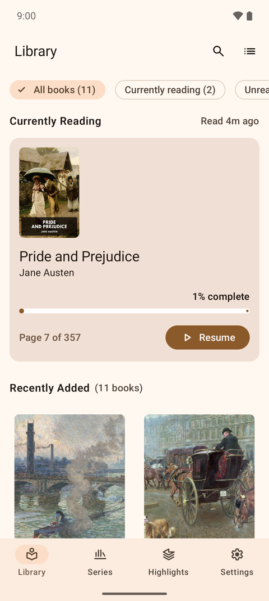
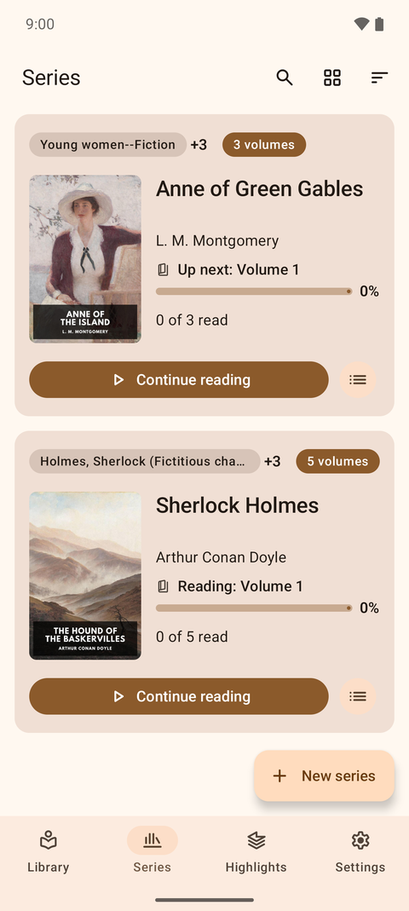
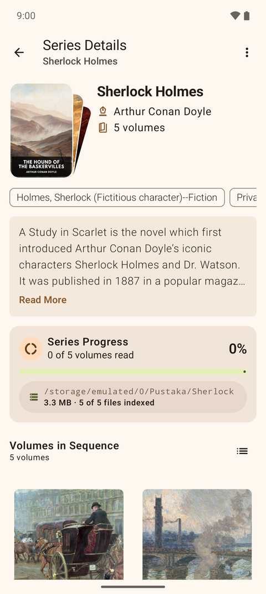
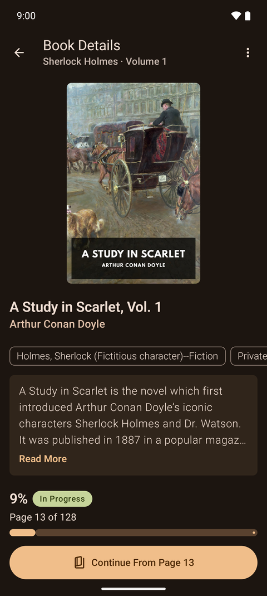
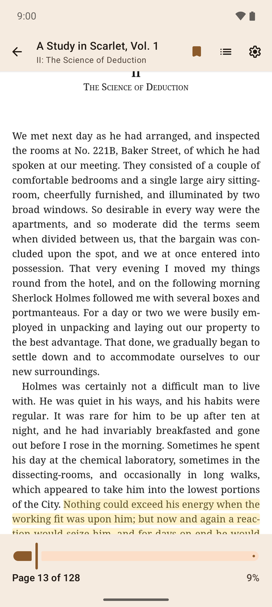
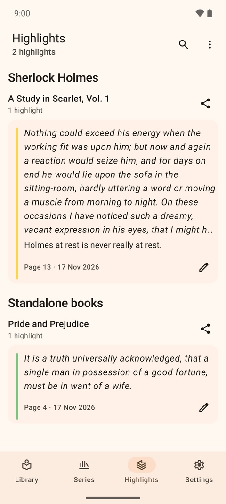
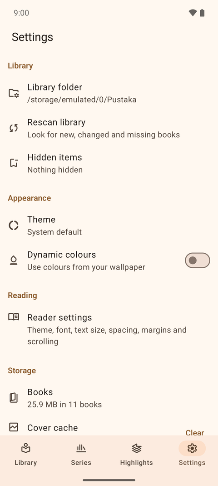
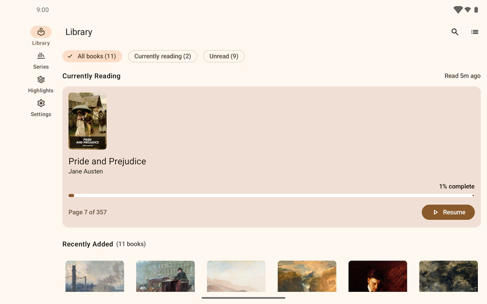

# Pustaka

[](#how-pustaka-is-made)

Pustaka is an offline EPUB reader for Android, built for books that come in series, such as light novels and manga.

You keep your EPUB files in a `Pustaka` folder on your phone, either loose or in one subfolder per series. Pustaka scans that folder, reads each book's details from the EPUB itself, and keeps track of your reading progress and highlights. It never renames or moves your files.

> **Status:** version 1.1.0. See the [release notes](docs/releases/1.1.0.md) and the [roadmap](docs/ROADMAP.md).

## Screenshots
<table>
  <tr>
    <td align="center"><br><sub>Library</sub></td>
    <td align="center"><br><sub>Series</sub></td>
    <td align="center"><br><sub>Series details</sub></td>
    <td align="center"><br><sub>Book details, dark theme</sub></td>
  </tr>
  <tr>
    <td align="center"><br><sub>Reader</sub></td>
    <td align="center"><br><sub>Highlights</sub></td>
    <td align="center"><br><sub>Settings</sub></td>
    <td></td>
  </tr>
</table>

<p align="center"><br><sub>On a tablet</sub></p>

The books shown are public-domain ebooks from [Standard Ebooks](https://standardebooks.org).

## Features
- A library built from a folder you manage yourself: put EPUBs directly in `Pustaka/` for standalone books, or in `Pustaka/<Series>/` for a series
- Title, authors, cover, description and volume number read automatically from each EPUB, and editable in the app
- A reader with page turning or scrolling, a table of contents, bookmarks and reader settings
- A "Back to page" button after jumping somewhere in a book
- Reading progress, reading statistics, and highlights you can export as Markdown
- Search, sorting, and a light or dark theme
- Layouts for phones and tablets
- Works offline, with no account

See [docs/local_storage_and_library.md](docs/local_storage_and_library.md) for how the library folder works.

## Installation
Pustaka is distributed through [GitHub Releases](https://github.com/naqibrafiqi/pustaka/releases), not the Play Store. Download the APK from the latest release and open it on your phone. Pustaka needs the **"All files access"** permission to read your `Pustaka` folder.

## Tech stack
- Kotlin, Jetpack Compose, Material 3
- Navigation 3
- Hilt (dependency injection), Room (database)
- [Readium Kotlin Toolkit](https://github.com/readium/kotlin-toolkit) for reading and displaying EPUBs
- Coil (image loading)

Requires Android 10 (API 29) or newer.

## Building
```bash
./gradlew assembleDebug
```
The build needs JDK 17 or newer (Android Studio's bundled JDK works) and an Android SDK with API 37.

Tests:
```bash
./gradlew testDebugUnitTest
```
```bash
./gradlew connectedDebugAndroidTest
```
The second runs the UI tests on a connected phone or emulator, and uninstalls the app afterwards. [docs/RELEASING.md](docs/RELEASING.md) explains how to build and sign a release.

## How Pustaka is made
Pustaka is vibe coded. From Phase 1 on, the code, tests and docs in this repository have been written by Claude, Anthropic's AI model, working in [Claude Code](https://claude.com/claude-code). Claude also wrote the [roadmap](docs/ROADMAP.md) and the Phase 0 housekeeping. Before that, the project owner wrote the first commits by hand: project setup, navigation and early designs of the Library, Series, Series Details and Book Details screens.

- **The project owner** acts as product manager: they decide what the app should do, make the calls recorded as decisions D1, D2 and so on in the [roadmap](docs/ROADMAP.md), and review and try out each phase before it's merged.
- **Claude** acts as the engineer: it plans each phase, writes the code and tests, builds the app, and opens a pull request per phase.

Every commit Claude writes ends with a `Co-Authored-By: Claude` line, so `git log` shows which work is Claude's.

Claude Code also loads the Android skills in [.claude/skills](.claude/skills/README.md). They're copied from Google's and a community skills repository, at pinned commits.
